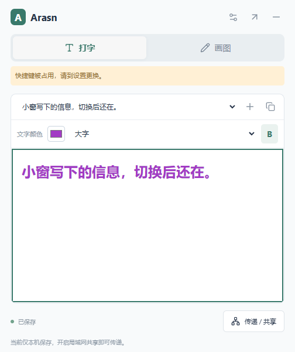

# Arasn Notebook · 办公随手页

按快捷键呼出一张自由编辑的工作页，放下文字便笺、鼠标草图，与同一局域网里的同事一起使用。

**当前版本：0.5.0，Windows 桌面原型，可运行。** 用户最新定位为局域网办公共享，本版取代之前的云账号 / 发送卡片方案。

默认以 520×640 的快捷小窗打开，顶部可随时切换“打字 / 画图”；内容分别保留，切换不清空。右上角可展开完整页面。



[画图小窗](docs/screenshots/quick-draw.png) · [完整页面](docs/screenshots/office-board.png)

## 直接试用

本机入口：`release/ArasnNotebook-0.5.0-win32-x64/ArasnNotebook.exe`。双击即可，不需要 Node.js。
换电脑时必须复制整个文件夹，不能只拷贝 exe。该目录不提交 Git；这是未签名的内部试用包，未发布 GitHub Release。

1. 按 **Ctrl+Alt+N** 呼出 / 隐藏小窗。快捷键被占用时，从托盘打开并在设置更换。
2. 小窗直接输入文字；加号新增便笺，下拉框切换已有便笺。展开完整页面后可以拖动文字位置。
3. 点“画图”切换鼠标绘图，再点“打字”继续输入；小窗提供颜色、删除笔迹和撤销，完整页面提供笔宽与缩放。
4. 内容自动保存。关闭窗口隐藏到托盘，彻底退出请用托盘菜单。
5. 点“局域网共享 → 开启共享”，把链接交给同网络同事，对方用浏览器打开即可编辑。

主机必须保持运行。若 Windows 防火墙询问权限，仅在信任的专用办公网络中允许通信；多网卡时选择对方能访问的地址。

## 能力与边界

- 一张 1600×1000 工作页；文字便笺、矢量笔迹、PNG 与完整 JSON 备份导出。
- 同时编辑不同对象会合并；同对象冲突保留本机副本，可恢复为新内容。
- 已打开页面断网仍可编辑，队列保存在本机；主机恢复且链接有效后补发。
- 默认不共享，每次开启生成新凭证；持有链接的人可编辑整页，停止共享即关闭监听。
- 浏览器参与者没有全局快捷键；尚未实现桌面加入另一主机、多页、成员权限、设备发现或云同步。
- HTTP 与本机数据未加密，仅适用于可信局域网，不用于公共互联网暴露。
- 长便笺可滚动。PNG 取每张便笺前四行与笔迹；全文请导出 JSON，JSON 导入尚未实现。
- Electron 便携目录约 357 MiB，尚未优化包体；当前“轻便”主要体现在呼出和编辑流程。

## 从源码运行

需要 Windows x64、Node.js 24 和 npm。

```powershell
npm ci
npx install-electron --no
npm start
```

若 GitHub 二进制下载失败，可在当前会话使用镜像重试；安装器仍校验包内官方校验和：

```powershell
$env:ELECTRON_MIRROR='https://npmmirror.com/mirrors/electron/'
npx install-electron --no
```

```powershell
npm run build
npm test
npx playwright install chromium
npm run test:ui
npm run test:desktop
npm run pack
node tests/desktop-smoke.cjs --packaged
```

`npm run dev` 仅为前端 Vite 服务，没有白板 API；完整运行请用 `npm start`。
桌面测试使用隔离数据目录；运行前退出其他 Arasn 实例，避免单实例锁与快捷键占用。

## 数据与文档

桌面数据位于 Electron 用户数据目录（Windows 通常为 `%APPDATA%/arasn-notebook`）：`board.json` 为白板，`recovery.json` 为待提交操作及冲突副本，`settings.json` 为快捷键、主题、置顶与启动显示偏好。删除程序目录不会主动删除这些数据，排查前先备份数据目录。

- [产品与技术设计](docs/MVP-DESIGN.md)
- [开发与验收状态](docs/MVP-PLAN.md)
- [验证记录](docs/VALIDATION.md)
- [交接单](HANDOFF.md)

## 个性化设置（0.3.0）

在左下角“设置与快捷键”中配置：

- 自定义快捷键：点击输入框后按组合键，再点保存；支持 Ctrl / Alt / Win 加字母、数字、方向键和功能键，冲突时保留原快捷键。
- 外观主题：浅色、深色、跟随系统，切换后即时生效。浏览器参与者也可单独设置主题。
- 开机自启动：仅在 Windows 打包程序可用，默认关闭；启用后登录 Windows 会运行当前 exe。
- 开机启动时隐藏到托盘：默认开启，手动启动仍显示工作页。
- 窗口始终置顶：默认关闭，可在输入和参考其他办公窗口时开启。

主题、快捷键、置顶和启动显示偏好重启后保留；自启动状态从 Windows 读取。移动便携目录前先关闭自启动，移动后在新位置重新开启，以更新程序路径。

设置集成测试：先执行 `npm run pack`，再运行 `node tests/settings-smoke.cjs`。该测试模拟自启动系统接口，不修改真实启动项，也不代表已进行真实开机验证。

## 核心交互验证（0.4.0）

`node tests/quick-panel.cjs`（先打包）：验证默认小窗尺寸、打字/画图反复切换不丢内容、展开/收回一致性，以及桌面小窗和独立浏览器之间的双向文字/笔迹同步。快捷键再次呼出时回到小窗；Esc 在非输入法组合状态下收起小窗，弹窗打开时先关闭弹窗。

## 0.5.0 文字、图形与快捷键

- 文字：自定义颜色、14/18/24/32 四档字号、加粗；小窗和完整页面均可设置，完整页面先选中文字便笺。
- 绘图：画笔、直线、箭头、矩形、椭圆（等宽高时为圆形）、三角形；鼠标按住拖动生成，支持自定义颜色与四档笔宽。
- 图形仍以兼容的矢量笔迹保存，可撤销、删除、PNG 导出及局域网共享。文字样式也随内容同步，旧便笺保持兼容。
- 快捷键：允许 Shift、Win、Ctrl、Alt 组合，也可单独使用 F1–F24 或 PrintScreen。系统保留或其他应用占用的键可能无法注册，失败时保留原设置；不支持只按一个修饰键或单独普通字母，避免接管正常输入。

本机旧版运行中，因此新版独立放在 `release/ArasnNotebook-0.5.0-win32-x64/ArasnNotebook.exe`；桌面快捷方式指向新版。先在托盘退出旧版，再打开桌面快捷方式；当前白板数据继续使用原用户数据目录。若之前开启了自启动，请在新版中关闭后重新开启一次，以更新启动路径。

重新生成独立版本包：`npm run pack:versioned`。测试指定新版：在 PowerShell 设置 `$env:ARASN_TEST_EXE` 为新 exe 的完整路径，再运行 `node tests/quick-panel.cjs` 或 `node tests/settings-smoke.cjs`。
