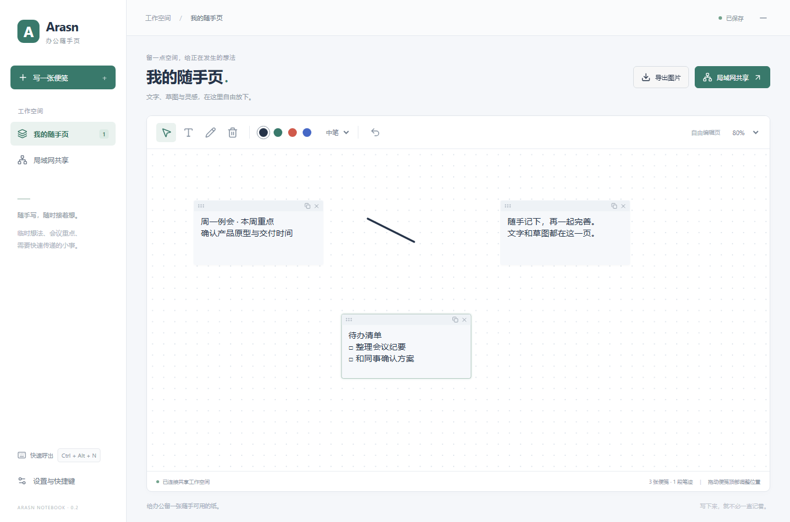

# Arasn Notebook · 办公随手页

按快捷键呼出一张自由编辑的工作页，放下文字便笺、鼠标草图，与同一局域网里的同事一起使用。

**当前版本：0.2.0，Windows 桌面原型，可运行。** 用户最新定位为局域网办公共享，本版取代之前的云账号 / 发送卡片方案。



## 直接试用

本机入口：`release/ArasnNotebook-win32-x64/ArasnNotebook.exe`。双击即可，不需要 Node.js。
换电脑时必须复制整个文件夹，不能只拷贝 exe。该目录不提交 Git；这是未签名的内部试用包，未发布 GitHub Release。

1. 按 **Ctrl+Alt+N** 显示 / 隐藏工作页。快捷键被占用时，从托盘打开并在设置更换。
2. 点击空白处或“写一张便笺”添加文字，拖动便笺顶部调整位置。
3. 选择画笔用鼠标绘图，支持颜色、笔宽、删除笔迹、操作撤销与缩放。
4. 内容自动保存。关闭窗口隐藏到托盘，彻底退出请用托盘菜单。
5. 点“局域网共享 → 开启共享”，把链接交给同网络同事，对方用浏览器打开即可编辑。

主机必须保持运行。若 Windows 防火墙询问权限，仅在信任的专用办公网络中允许通信；多网卡时选择对方能访问的地址。

## 能力与边界

- 一张 1600×1000 工作页；文字便笺、矢量笔迹、PNG 与完整 JSON 备份导出。
- 同时编辑不同对象会合并；同对象冲突保留本机副本，可恢复为新内容。
- 已打开页面断网仍可编辑，队列保存在本机；主机恢复且链接有效后补发。
- 默认不共享，每次开启生成新凭证；持有链接的人可编辑整页，停止共享即关闭监听。
- 浏览器参与者没有全局快捷键；尚未实现桌面加入另一主机、多页、成员权限、设备发现或云同步。
- HTTP 与本机数据未加密，仅适用于可信局域网，不用于公共互联网暴露。
- 长便笺可滚动。PNG 取每张便笺前四行与笔迹；全文请导出 JSON，JSON 导入尚未实现。
- Electron 便携目录约 357 MiB，尚未优化包体；当前“轻便”主要体现在呼出和编辑流程。

## 从源码运行

需要 Windows x64、Node.js 24 和 npm。

```powershell
npm ci
npx install-electron --no
npm start
```

若 GitHub 二进制下载失败，可在当前会话使用镜像重试；安装器仍校验包内官方校验和：

```powershell
$env:ELECTRON_MIRROR='https://npmmirror.com/mirrors/electron/'
npx install-electron --no
```

```powershell
npm run build
npm test
npx playwright install chromium
npm run test:ui
npm run test:desktop
npm run pack
node tests/desktop-smoke.cjs --packaged
```

`npm run dev` 仅为前端 Vite 服务，没有白板 API；完整运行请用 `npm start`。
桌面测试使用隔离数据目录；运行前退出其他 Arasn 实例，避免单实例锁与快捷键占用。

## 数据与文档

桌面数据位于 Electron 用户数据目录（Windows 通常为 `%APPDATA%/arasn-notebook`）：`board.json` 为白板，`recovery.json` 为待提交操作及冲突副本，`settings.json` 为快捷键。删除程序目录不会主动删除这些数据，排查前先备份数据目录。

- [产品与技术设计](docs/MVP-DESIGN.md)
- [开发与验收状态](docs/MVP-PLAN.md)
- [验证记录](docs/VALIDATION.md)
- [交接单](HANDOFF.md)
