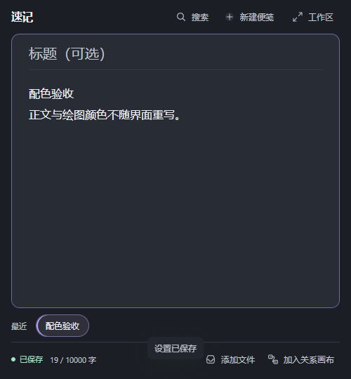

# Arasn Notebook · 办公随手页

按快捷键呼出一张自由编辑的工作页，放下文字便笺、鼠标草图，与同一局域网里的同事一起使用。

**当前版本：0.6.0，Windows 桌面原型，可运行。** 用户最新定位为局域网办公共享，本版取代之前的云账号 / 发送卡片方案。

默认打开统一工作站。快捷键可直接进入便签的快捷记录布局，展开便签库即可搜索和管理历史记录。标题、正文和附件在两种布局中共用。沿用 Graphite 亮暗主题，可在“设置 → 外观 → 主题”选择浅色、深色或跟随系统。



[自由工作页](docs/screenshots/color-batch3/final/canvas-dark-1440.png) · [关系画布](docs/screenshots/package-sync-2026-11-15/color-retry/relation-dark-390.png) · [文件页](docs/screenshots/package-sync-2026-11-15/color-retry/files-dark-1440.png)

## 直接试用

本机打包入口：根目录 `Arasn-0.6.0-Portable.exe`、`Arasn-0.6.0-Setup.exe`，或 `release/ArasnNotebook-0.6.0-win32-x64/ArasnNotebook.exe`。成品不需要 Node.js；复制文件夹版到其他电脑时必须复制整个目录。
这些构建产物不提交 Git，当前未发布 GitHub Release；克隆仓库后可按下文从源码运行或自行打包。

1. 按 **Ctrl+Alt+N** 呼出 / 隐藏小窗。快捷键被占用时，从托盘打开并在设置更换。
2. 小窗直接输入标题与正文，最近记录胶囊切换已有便笺；正文自动保存，切换保留选区。
3. 在工作页绘图与放置空间便签；关系画布通过引用组织同一份原记录，独立便签页负责正文编辑，文件页管理本机副本和附件。
4. 内容自动保存。关闭窗口隐藏到托盘，彻底退出请用托盘菜单。
5. 点“设备互传 → 白板实时共享”，选择与同事处于同一局域网的网卡后开启共享，把链接交给对方用浏览器打开即可编辑共享文字与笔迹。

主机必须保持运行。若 Windows 防火墙询问权限，仅在信任的专用办公网络中允许通信。网卡显示系统名称与私有 IPv4；疑似虚拟标记仅按名称判断，优先尝试不保证连通。共享仅监听所选地址，切换前先停止；网络变化后点击刷新检查。

## 能力与边界

- 自由工作页支持平移缩放、文字便笺、图形、笔刷预设和笔迹擦除；关系画布支持连接、详情、搜索、整理确认及撤销重做。
- 独立文件页提供搜索分类、列表/网格、PNG/JPEG原图预览、附件引用、回收恢复与数据检查；设备互传当前传送便签，不传文件。
- 同时编辑不同对象会合并；同对象冲突保留本机副本，可恢复为新内容。
- 已打开页面断网仍可编辑，队列保存在本机；主机恢复且链接有效后补发。
- 默认不共享，每次开启生成新凭证；持有链接的人可查看和编辑共享文字与笔迹，无需设备批准。本机文件、附件和关系画布不共享；便签互传配对不改变白板访问权。停止共享关闭监听并断开连接。
- 浏览器参与者没有全局快捷键；白板共享未提供按设备批准/撤销，便签互传有独立的发现与配对流程。未提供云同步。
- HTTP 与本机数据未加密，仅适用于可信局域网，不用于公共互联网暴露。
- PNG导出支持完整/当前视口及1/2/4倍、全文排版与安全尺寸限制；关系图可单独导出。完整展开正文可能覆盖邻近对象，导出界面会说明限制。
- 桌面成品仍包含Electron运行时，包体尚未优化；物理输入、真实登录/双机、混合DPI、安装升级及长稳验收尚未完成，旧偶发输入问题根因未确定。

## 从源码运行

需要 Windows x64、Node.js 24 和 npm。

```powershell
npm ci
npx install-electron --no
npm start
```

若 GitHub 二进制下载失败，可在当前会话使用镜像重试；安装器仍校验包内官方校验和：

```powershell
$env:ELECTRON_MIRROR='https://npmmirror.com/mirrors/electron/'
npx install-electron --no
```

```powershell
npm run build
npm test
npx playwright install chromium
npm run test:ui
npm run test:desktop
npm run pack
node tests/desktop-smoke.cjs --packaged
```

`npm run dev` 仅为前端 Vite 服务，没有白板 API；完整运行请用 `npm start`。
桌面测试使用隔离数据目录；运行前退出其他 Arasn 实例，避免单实例锁与快捷键占用。

## 数据与文档

桌面数据位于 Electron userData（通常 `%APPDATA%/arasn-notebook`）：`workspace.sqlite` 保存元数据、面板、设置和恢复队列，`objects/` 按 UUID 保存原件，`staging/` 为中间文件，`thumbnails/` 为缓存，`backups/` 为安全备份。首次启动迁移旧 JSON 并保留原文件，迁移后请勿继续使用旧版写旧 JSON。

- [产品与技术设计](docs/MVP-DESIGN.md)
- [开发与验收状态](docs/MVP-PLAN.md)
- [验证记录](docs/VALIDATION.md)
- [交接单](HANDOFF.md)
- [主题第二批](docs/THEME-BATCH2-2026-11-15.md) · [配色第三批](docs/COLOR-BATCH3-2026-11-15.md) · [最新本机成品同步](docs/LOCAL-PACKAGE-SYNC-2026-11-15.md)

以下为历史版本记录，当前界面与验收状态以以上最新报告和交接单为准。

## 个性化设置（0.3.0）

在左下角“设置与快捷键”中配置：

- 自定义快捷键：点击输入框后按组合键，再点保存；支持 Ctrl / Alt / Win 加字母、数字、方向键和功能键，冲突时保留原快捷键。
- 外观主题：浅色、深色、跟随系统，切换后即时生效。浏览器参与者也可单独设置主题。
- 开机自启动：仅支持固定位置的 Windows 打包程序；开发环境、便携 EXE 和临时解压路径禁用。保存后回读系统注册与启动批准状态，失败时恢复原注册；实际登录运行仍需实机验证。
- 开机启动时隐藏到托盘：默认开启，手动启动仍显示工作页。
- 窗口始终置顶：默认关闭，可在输入和参考其他办公窗口时开启。

主题、快捷键、窗口布局和启动显示偏好重启后保留；自启动状态从 Windows 读取。在任务管理器或系统设置中修改启动项后，可重新打开设置或点击“刷新系统状态”。固定目录版本移动前先关闭自启动，移动后重新开启；便携 EXE 请改用安装版。

设置集成测试：先执行 `npm run pack`，再运行 `node tests/settings-smoke.cjs`。该测试模拟自启动系统接口，不修改真实启动项，也不代表已进行真实开机验证。

## 核心交互验证（0.4.0）

使用 `node tests/unified-notes-desktop.cjs` 在 Windows 验证快捷呼出、便签自动保存、附件、工作页和关系画布，并捕获原生窗口截图。

## 0.5.0 文字、图形与快捷键

- 文字：自定义颜色、14/18/24/32 四档字号、加粗；小窗和完整页面均可设置，完整页面先选中文字便笺。
- 绘图：画笔、直线、箭头、矩形、椭圆（等宽高时为圆形）、三角形；鼠标按住拖动生成，支持自定义颜色与四档笔宽。
- 图形仍以兼容的矢量笔迹保存，可撤销、删除、PNG 导出及局域网共享。文字样式也随内容同步，旧便笺保持兼容。
- 快捷键：允许 Shift、Win、Ctrl、Alt 组合，也可单独使用 F1–F24 或 PrintScreen。系统保留或其他应用占用的键可能无法注册，失败时保留原设置；不支持只按一个修饰键或单独普通字母，避免接管正常输入。

本机旧版运行中，因此新版独立放在 `release/ArasnNotebook-0.6.0-win32-x64/ArasnNotebook.exe`；桌面快捷方式指向新版。先在托盘退出旧版，再打开桌面快捷方式；当前白板数据继续使用原用户数据目录。若之前开启了自启动，请在新版中关闭后重新开启一次，以更新启动路径。

重新生成独立版本包：`npm run pack:versioned`。运行源码版工作站专项前先构建，再执行 `node tests/unified-notes-desktop.cjs`。

## 0.6.0 本地文件与存储核心

在小窗选择“文件”，拖入多个文件，或使用导入/主动粘贴。支持分页、搜索、分类、重命名、导出、面板引用、批量软删除和回收站恢复。“清空面板”只清空元素与引用，不删除原件。恢复与数据检查中提供备份、恢复、校验及重试失败导入；默认不自动清理。

- [核心模块和数据模型](docs/CORE-ARCHITECTURE.md)
- [本轮验收与基准](docs/CORE-VALIDATION.md)

新版独立位于 `release/ArasnNotebook-0.6.0-win32-x64/ArasnNotebook.exe`。先从托盘退出旧版；如旧版启用过自启动，请在新版关闭/开启一次以更新路径。文件目前只在本机，不经局域网传输。
