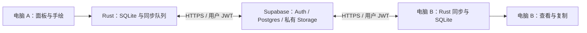

# Arasn Notebook：MVP 产品与技术设计

文档版本：0.1；目标应用版本：0.1.0；日期：2026-11-01。
状态：可实施的首版设计，未实现、未部署、未完成性能或双机验证。

## 1. 目标与边界

让用户在电脑 A 按快捷键，写一句话或画一张简图，发送后在电脑 B 快速取用。验收核心是“呼出 → 记录 → 发送 → 另一台电脑取用”。

**用户已确认：Windows 优先，通过互联网同步。** 下文其余产品取舍和技术选型是本次设计的实施基线，可由后续实际反馈调整，不等同于用户逐项确认。

首版支持 Windows 11 x64；Windows 10、ARM、macOS、Linux 暂不作为验收平台。面向个人自己的多台电脑，同一账号共享一个收件箱；不做给其他用户发消息、指定目标设备或多人协作。

| 首版必须有 | 完成边界 |
| --- | --- |
| 全局快捷键 | 默认 Ctrl+Alt+N，可更改；冲突时可从托盘打开设置 |
| 文字输入 | 多行纯文本，保留换行，支持中文输入法 |
| 简单手绘 | 单页画布、三种笔宽、黑红蓝三色、撤销与重做、确认后清空 |
| 卡片发送 | 文字、手绘或二者组合，明确按“发送”才进入同步 |
| 互联网同步 | 同账号电脑可看到已发送卡片；失败可重试 |
| 本地可靠性 | 草稿自动保存，待发送任务持久化，重启可恢复 |
| 内容取用 | 复制文字；图片复制到剪贴板或保存为 PNG |
| 基本管理 | 最近记录、手动刷新、删除已发送卡片、登录和退出 |

不纳入 0.1.0：富文本、Markdown 渲染、无限画布、压感、独立橡皮工具、截图识别、文件传输、自动读取剪贴板、搜索标签、移动端、局域网直连、自动更新、端到端加密。手绘用撤销重画纠错；原笔迹仅用于本机草稿编辑，发送后跨设备查看 PNG。

## 2. 用户流程

### 首次启动

1. 打开应用，创建本机数据库和设备随机 UUID，显示面板与托盘入口。
2. 提示默认快捷键及当前注册结果；失败时应用仍可通过托盘使用。
3. 可立即离线写草稿。互联网发送需登录，首版采用邮箱验证码登录；实际邮件送达和额度需部署时验证。
4. 两台电脑登录同一邮箱账号，即共享已发送卡片；电脑名称仅用于来源展示，不参与授权。
5. 开机启动首版不实现；应用未运行时全局快捷键不能呼出。

### 日常发送与接收

1. 快捷键呼出面板，焦点落在文字输入框，恢复本机当前草稿。
2. 输入文字，可切换“手绘”添加简图；文字和画布共同属于当前草稿。
3. 点击发送或按 Ctrl+Enter，将草稿冻结成卡片；事务成功后清空编辑区。
4. 立即显示“待发送”；只有服务端确认卡片存在且图片可读取，才显示“已同步到云端”。这不等于另一台电脑已收到。
5. 电脑 B 打开面板时刷新收件箱；查看、复制或导出卡片。接收内容不会抢焦点或自动改写剪贴板。
6. 已发送卡片不可原地编辑。“再次编辑”复制为本机新草稿，再次发送会创建新卡片。

### 窗口和键盘

- 默认面板约 760×600 逻辑像素，允许调整大小，最小 600×440；低分辨率屏幕限制在可用工作区。
- 快捷键在按下事件触发一次：隐藏时显示并请求焦点，显示时隐藏；忽略按键自动重复。
- Esc 或关闭按钮隐藏到托盘，保留草稿；失焦不自动隐藏，避免影响绘图或文件选择。
- 仅显示时临时置顶；托盘提供“打开面板 / 设置 / 退出”。退出前完成本地写入，不阻塞等待网络。
- 输入法组合期间 Ctrl+Enter 不发送，Esc 优先交给输入法；Tab 可访问所有按钮，按钮具备名称和可见焦点。
- 多屏拔插后将窗口移回可用显示器；100%、150%、200% 缩放需实机验收。

## 3. 面板布局

```text
┌ Arasn Notebook                 同步状态 · 设置 · 隐藏 ┐
│ [文字] [手绘]                                        │
│ 写点什么……                                           │
│                                                      │
│ 手绘区（切换后显示） 颜色 / 笔宽 / 撤销 / 重做 / 清空    │
│ 草稿已保存                         [发送 Ctrl+Enter]   │
├ 最近记录 ─────────────────────────────── [刷新] ──────┤
│ 来源电脑 · 时间 · 待发送 / 已同步 / 失败                │
│ 文字摘要 / 图片缩略图      [查看] [复制] [更多]         │
└──────────────────────────────────────────────────────┘
```

编辑区始终可用，历史列表独立滚动，每页 50 条。首次拉取完成前显示加载状态，不以空列表暗示没有记录。同步状态同时显示上次成功时间；云端错误不遮挡本地编辑。

## 4. 技术方案

| 部分 | 实施基线 | 目的 |
| --- | --- | --- |
| 桌面容器 | Tauri 2 + Rust | 托盘、窗口、单实例和全局快捷键 |
| 界面 | React + TypeScript + Vite | 编辑、列表、设置和状态展示 |
| 手绘 | 浏览器 Canvas 2D + Pointer Events | 固定画布绘制与 PNG 导出，无额外绘图框架 |
| 本地存储 | Rust 侧 SQLite + 本机应用数据目录 | 原子保存草稿、卡片、同步队列 |
| 云端 | Supabase Auth + Postgres + 私有 Storage | 身份验证、卡片元数据、图片对象 |
| 同步执行 | Rust 后台任务，通过 HTTPS API | 隐藏面板时仍可补发和接收 |
| 凭据 | Windows Credential Manager | 保存刷新令牌，访问令牌仅保留内存 |

选 Tauri 是为了使用系统 WebView 和原生桌面能力；体积、内存、焦点可靠性均需原型实测，本文不承诺现成指标。首个技术关卡必须验证 Windows WebView2、快捷键、中文输入法、PNG 剪贴板与托盘行为，失败时再评估容器替换。



前端只通过窄范围 Tauri commands 访问原生能力，不直接获得任意 SQL、文件路径或系统命令权限。Rust 检查所有输入、文件大小和当前账号。云端只配置项目地址和可公开的客户端 key；管理密钥不进入安装包。

### 建议目录（实现阶段才创建）

```text
src/                    React 界面、画布、状态
src-tauri/src/          窗口、凭据、数据库、同步、剪贴板
src-tauri/migrations/   SQLite 迁移
supabase/migrations/   云表、约束、权限策略
tests/                  同步及权限测试
docs/                   设计与验收
```

## 5. 内容模型与本地持久化

### 本地模型

| 实体 | 关键字段及约束 |
| --- | --- |
| drafts | draft_id、owner_scope、text、strokes_json、updated_at；每设备每账号一个活动草稿 |
| cards | id(UUIDv4)、owner_scope、user_id、device_id、device_name、text、image_path、payload_hash、client_created_at、server_created_at、deleted_at、sync_state |
| outbox | operation_id、card_id、user_id、operation(create/delete)、attempts、next_retry_at、last_error；每卡片串行 |
| settings | 快捷键、设备显示名、画笔偏好；不存令牌 |

owner_scope 为账号 UUID 或独立 guest 命名空间。未登录草稿只有在用户点击“使用当前草稿”后才复制到当前账号；禁止自动绑定给后来登录的账号。卡片和队列创建时固定 user_id，不随登录切换修改。

文字最多 20,000 个 Unicode 字符且 UTF-8 不超过 64 KiB；两项都检查。空白文字且无笔迹不可发送。画布逻辑大小 1024×640，按宽高比展示，用规范坐标保存笔迹，PNG 为白底，输出最多 5 MiB；采样笔迹限 100,000 点，达到限制前提示。

草稿停止输入 500 ms 后落盘，笔画结束后落盘；隐藏、发送和退出时立即刷盘。异常断电仍可能丢失最近一个保存窗口，不能宣称零丢失。

发送时先将 PNG 原子写入应用目录，再在一个 SQLite 事务内写入冻结卡片、outbox 并清除草稿。磁盘失败保留编辑区，不显示发送成功；启动时清理未被数据库引用的临时文件。文件和 SQLite 无法跨资源事务，需用此顺序和恢复步骤补齐。

### 云端模型

`cards` 表只存卡片元数据；不上传草稿和原始笔迹。

| 字段 | 定义 |
| --- | --- |
| id / user_id | UUID 主键 / Auth 用户 ID，服务端校验用户归属 |
| device_id / device_name | 来源标记；设备名称最多 64 字符 |
| text | 纯文本，可空；有图片或有非空白文字至少满足一项 |
| image_path | 可空，固定为 `{user_id}/{card_id}.png`，不接受其他账号目录 |
| payload_hash | 对规范化文字与图片摘要计算的 SHA-256，用于重复请求核对 |
| client_created_at | 客户端记录时间，仅用于辅助展示 |
| server_created_at | 服务端生成时间，用于远端历史展示 |
| deleted_at | 服务端生成的软删除时间，初始为空 |

主键防重复；索引 `(user_id, server_created_at, id)` 支持历史查询。远端只允许插入、读取和软删除；禁止客户端修改正文、归属、主键与服务端时间。软删除通过受限函数执行，校验当前用户，只设置 deleted_at，重复调用保持幂等；普通 UPDATE/DELETE 不授权。

云端字段长度、路径和有效内容约束与客户端一致，并由数据库约束和 Storage 上传限制再次执行。首版保留删除标记，不以“过期”清理标记；否则长期离线设备可能重新显示旧卡片。

## 6. 同步协议与失败恢复

### 发送：至少一次请求，幂等落库

1. 所有发送任务先持久化；恢复登录、网络恢复或手动重试时继续执行。
2. 有图片时先上传私有对象，再插入云卡片。重复上传只允许同账号同路径相同内容，发现摘要不一致则报错，不能覆盖。
3. 插入超时后按相同 card_id 查询；同账号且 payload_hash 相同则视为已完成，不同则停在错误状态。使用 INSERT，不用可覆盖正文的通用 upsert。
4. 图片读取可用、卡片确认存在后，本机卡片转为 synced，移除 create 任务。
5. 云插入失败时不发布半成品卡片；遗留对象保留供原任务重试。完全放弃任务产生的孤儿对象由后续维护清理，不阻塞首版主链路。

状态：`queued → syncing → synced`；临时错误转 `retry_wait`，以 1、2、4、8 秒递增至 60 秒并加入抖动；重启后恢复超时的 syncing 任务。401 先刷新一次令牌，刷新失败转 `auth_required`；限流遵守 Retry-After；权限、超限和内容冲突转 `failed`，保留本地副本并提示处理。

### 接收：小规模全量元数据扫描

为避免时间戳游标遗漏、并发提交顺序和修改冲突，首版不做增量游标、WebSocket 或实时共同编辑。面板打开时立即扫描；可见时每 5 秒扫描，隐藏时每 30 秒扫描，休眠期间停止，唤醒立即补扫；同一时刻只运行一个扫描。

每次扫描按不可变的 UUID 升序，以 id 做 keyset 分页，每页 100 条，包含 deleted_at；完成一轮后下一轮从头开始。并发插入到已扫描区间的卡片在下一轮补到，不凭单轮缺失删除本地内容。每页写入 SQLite 事务；中断后可重新从头扫描。

先展示文字和图片加载占位，再下载图片到本机缓存；图片失败可单独重试。该方案以每账号约 1,000 张卡片作为首版容量测试档位，不是云端强制上限；数据增长时请求量会增加，必须先测量再升级同步协议。

### 删除、并发和账号切换

- 删除需确认，说明会从所有已登录电脑的历史中移除。离线先隐藏本机卡片并排队，收到云端确认后才显示删除完成。
- 对同卡片 create/delete 串行，先确认 create 再执行 delete；若远端已有删除标记，不可由重试发送复活。拉取期间本机存在待删除任务时不重新显示该卡片。
- 删除标记保留；本机合并一旦见到 deleted_at，晚到的未删除扫描结果不可清空它。图片删除失败可重试，不回滚已确认的逻辑删除。已下载的离线副本无法被云端即时抹除，设备联网后才清理缓存。
- 不同电脑只能新增或删除同一卡片，不能覆盖正文，因此不引入 CRDT。删除与“再次编辑”并发时，新草稿与新卡片不受旧卡片删除影响。
- 退出账号立即停止该账号网络任务，取消下载、清除令牌并隐藏该账号记录；本地离线队列保留到原账号重新登录。账号切换使用独立命名空间，并以会话代次丢弃过期网络响应；不能把账号 A 的任务用账号 B 的凭据补发。

## 7. 权限、隐私与部署

- Postgres 启用 RLS：SELECT 和 INSERT 只允许 `auth.uid() = user_id`；无登录用户不可访问。软删除函数以调用者身份执行，限定函数权限和搜索路径。
- 图片 bucket 必须私有。Storage 对 SELECT、INSERT、必要的删除权限校验路径第一段是当前账号；不授予任意覆盖。路径和卡片拥有者关联由服务端规则验证。
- 图片通过带用户令牌的请求读取，不生成永久公开 URL；本机预览仅访问受限应用目录。
- 只加载打包前端，使用限制性 CSP；纯文本按文本渲染，不能作为 HTML 执行。不记录正文、验证码或令牌到日志。
- Windows 凭据库存刷新令牌；SQLite、笔迹和 PNG 首版不加密，依赖操作系统账号权限。HTTPS 和账号隔离不等于端到端加密，云服务管理员具备读取能力。
- 后续开发需要单独创建 Supabase 项目、配置邮件验证码、执行迁移、创建 bucket 并核对所有权限。本文不承诺免费额度、服务稳定性或跨地区延迟。
- 仓库禁止提交 .env、数据库、私人内容、管理令牌和签名证书。发布前另行配置安装包签名；未签名的内部试用包需标注来源和风险，不计为正式公开发布。

## 8. 性能目标与验收条件

以下数值是设计目标，不是已测结果。测试记录需包含 CPU、内存、系统版本、缩放、网络地区、包版本与样本数。

| 项目 | 验收方法与目标 |
| --- | --- |
| 热呼出 | 应用已驻留，从按键到面板可输入，30 次 P95 ≤ 300 ms；冷启动另记 |
| 编辑响应 | 输入及普通画笔操作不因网络请求阻塞；1,000 卡片列表仍可流畅输入 |
| 草稿恢复 | 输入、画图、隐藏、重启后恢复；强退损失不超过保存窗口内未提交变更 |
| 文字同步 | 两机已登录、收件面板可见、稳定网络，20 次从发送到可读 P95 ≤ 10 秒 |
| 手绘同步 | PNG ≤ 1 MiB，在明确记录的 ≥10 Mbps 上行测试网络，20 次 P95 ≤ 15 秒 |
| 后台接收 | 接收端面板隐藏时允许 30 秒轮询延迟；重新打开立即刷新 |
| 断网重试 | 离线创建 20 卡片并重启，恢复网络后全部到达且不重复 |
| 权限 | 账号 B 无法读取、写入、删除账号 A 的卡片或图片；篡改路径同样失败 |
| 账号切换 | A 的在途请求晚到、A 离线待发送、切换 B 三种场景均不泄露内容 |
| 删除 | 离线删除、创建后立即删除、另一机离线后恢复，均不复活旧卡片 |
| 输入和窗口 | 中文组合输入不误发；快捷键冲突、重复启动、多屏和缩放均有可用入口 |

失败不得用“云端已同步”掩盖：分别记录本地保存、服务端确认、接收机显示时间。若轮询方案达不到同步目标，先测量请求与分页成本，再调整策略。

## 9. 分阶段交付与待验证点

按 [开发清单](MVP-PLAN.md) 完成原生能力验证、本地闭环、云端权限、跨机同步与试用包。首个可试用 MVP 必须让两台 Windows 实机完成文字、手绘、断网补发三条流程。

实施时需确认：Supabase 项目归属与地区、验证码邮件服务、两台测试机、签名条件。暂不为这些未配置资源声称已部署或通过验收。

## 10. 官方技术依据

核对日期：2026-11-01。以下资料支撑能力选择；协议、界面和目标数值由本项目定义。依赖确切版本及权限 API 在实施时再次核对并锁定。

- [Tauri 全局快捷键](https://v2.tauri.app/plugin/global-shortcut/)：桌面快捷键插件能力。
- [Tauri SQL](https://v2.tauri.app/plugin/sql/)：SQLite 支持与迁移参考；本项目将数据库操作收敛到 Rust commands，具体驱动在原型时确认。
- [Supabase RLS](https://supabase.com/docs/guides/database/postgres/row-level-security)：用户行权限隔离依据。
- [Supabase Storage 权限](https://supabase.com/docs/guides/storage/security/access-control)：私有对象访问策略依据。
