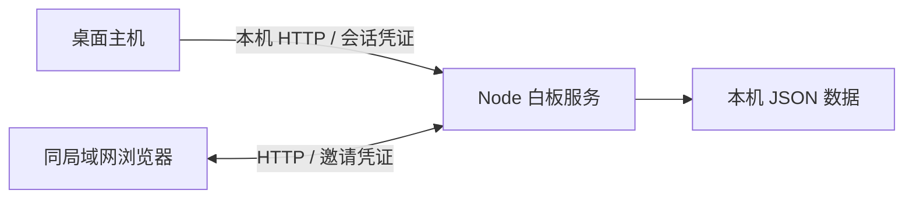

# 局域网办公原型设计

版本：0.3.0；更新：2026-11-01。

## 定位

用户最新要求：办公场景中轻便快速呼出、自由编辑文字与鼠标绘图、同一局域网共享。此要求覆盖此前的云端同账号卡片设计，旧方案保留于 Git 历史。

核心流程：快捷键呼出 → 随处写字或绘图 → 主动共享 → 同事进入同页。无需云账号；主机保存页面，持有链接的参与者都能编辑。

## 已实现的交互

- 1600×1000 固定页面，可滚动及缩放；可拖动文字便笺，每块最多 10,000 字符。
- 四色、三种笔宽，每笔最多 3,000 点；可删除整条笔迹或便笺。
- 对象操作可撤销；文本编辑使用输入框原生撤销。撤销不会覆盖他人的新修改，未实现重做。
- PNG 导出便笺前四行及笔迹；完整 JSON 备份保留全部文字、笔迹与冲突，未实现导入。
- 默认 Ctrl+Alt+N，支持按键录入自定义快捷键。关闭隐藏到托盘，托盘菜单可退出。
- 编辑焦点在文本框时 Esc 交给文本框 / 输入法，避免隐藏窗口打断中文组合输入。
- 开启共享后显示链接；停止共享关闭监听。应用重启后共享默认关闭。

## 实现选择

本机缺少 Rust 工具链，为先验证原生桌面与局域网流程，原型采用 **Electron + React + TypeScript + Node.js HTTP**。Electron 管理快捷键、单实例、托盘和窗口，SVG 展示矢量笔迹，Canvas 导出图片。

单页状态以 JSON 原子替换保存，不依赖 SQLite 或云服务。便携目录约 357 MiB，尚不满足极小包体目标。后续实测内存和启动性能后评估优化或迁回 Tauri，不将原型选择当作最终容器承诺。

默认只监听 127.0.0.1；用户开启共享才新增 0.0.0.0 监听器，端口由系统分配。本机和共享入口使用不同凭证。共享客户端不能调用桌面 IPC。

## 数据与同步

主状态为 `{ roomId, revision, items, receipts }`。

| 字段 | 定义 |
| --- | --- |
| roomId | 白板身份，避免队列跨页提交 |
| revision | 全页递增版本 |
| items[id] | 对象版本及 value；value 为文字、笔迹或删除标记 null |
| receipts[opId] | 最近 1,000 次操作签名，处理响应丢失重试 |

操作为 `{ id, opId, expected, value }`。服务端校验对象版本，再原子替换磁盘文件，成功后更新内存并确认。不同对象分别比较版本，相同对象冲突返回 409。

客户端持久化待发队列，连续未发送的同对象输入合并；发送中的操作保持不变。冲突时保留最新本机内容，并允许恢复为新对象。删除保留版本与 null，禁止同 ID 复活，撤销删除会创建新对象。

每秒检查版本，未变化返回 204，不传整页。恢复文件仅在内容变化时写入。桌面通过 IPC 保存恢复副本，防止本地端口变化后失去浏览器恢复数据；浏览器副本保存在该来源的 localStorage。

主机重开共享后端口与凭证可能变化，新链接不会自动迁移旧来源的离线草稿；关闭旧页前应导出 JSON。突然断电仍可能丢失尚未写盘的最近输入，不承诺零丢失。

容量边界：单次操作 256 KiB、状态文件 12 MiB、总对象含删除标记最多 5,000。超限报错并保留本机内容，不静默清理旧数据。

## 安全边界

- 共享凭证使用 192 位随机数，置于链接片段；页面读取后从地址栏移除，API 使用 Authorization 头。
- 数据 API 必须验证凭证；带 Origin 的请求需同源，不提供跨站 CORS。
- 静态服务仅提供构建页面和 assets，不能读取源码或用户数据。
- 服务端验证类型、坐标、颜色和大小；文字只作文本显示，不渲染 HTML。
- Electron 开启 contextIsolation、sandbox，关闭 nodeIntegration；禁止外部导航、新窗口和权限请求。
- IPC 校验窗口、主 frame 和来源，只提供共享开关、快捷键、隐藏及固定恢复文件操作。
- HTTP 和本机文件未加密；链接即整页编辑权，没有成员身份或权限分级。仅供可信局域网试用。

## 下一步与依据

先执行 [验证记录](VALIDATION.md) 的两机实测，再决定桌面加入共享、多页、备份导入和轻量容器的优先级。

实现时核对的官方资料：[全局快捷键](https://www.electronjs.org/docs/latest/api/global-shortcut)、[托盘](https://www.electronjs.org/docs/latest/api/tray)、[Electron 安全指南](https://www.electronjs.org/docs/latest/tutorial/security)。核对日期：2026-11-01。同步协议和产品交互由本项目定义。

## 0.3.0 个性化设置交付

已实现自定义快捷键、浅色/深色/跟随系统主题、开机自启动、开机时隐藏到托盘及窗口置顶。设置经主进程校验并持久化；开机自启动仅在打包后的 Windows 程序可用，操作系统记录当前 exe 路径与 --autostart 参数，不默认开启。

已验证设置界面、系统快捷键注册与冲突保留、主题切换及重启恢复；自启动接口通过模拟适配器验证，没有修改开发机真实启动项。真实开机行为、便携目录迁移后的自启动路径需现场验证。下一轮先读取本交接内容，并以 0.3.0 为准。
